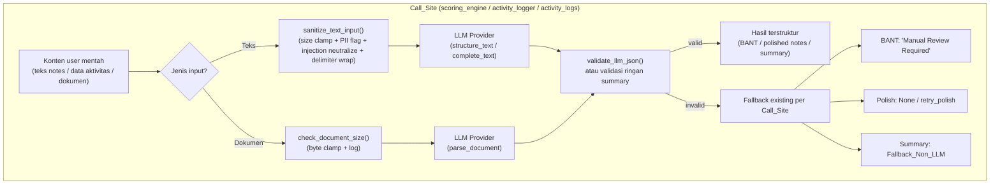

# Design Document

## Introduction

Dokumen ini merancang fitur **guardrails-llm**: lapisan keamanan terpusat yang membungkus semua pemanggilan LLM (Gemini) di backend Portal SA. Desain berpijak pada kode yang sudah ada — `backend/app/services/scoring_engine.py`, `backend/app/services/activity_logger.py`, `backend/app/api/activity_logs.py`, `backend/app/services/llm_provider.py`, dan `backend/app/core/config.py` — serta menghormati batasan di `AGENTS.md` dan `requirements.md`: **tidak ada perubahan model SQLAlchemy maupun migration Alembic**, hanya penambahan di layer `utils`, `services`, `api`, dan `config`.

Inti desain adalah satu module murni `backend/app/utils/guardrails.py` tanpa dependensi database/HTTP, sehingga sepenuhnya unit-testable, lalu diintegrasikan di tiga Call_Site LLM dengan memanfaatkan jalur retry/fallback yang sudah ada.

Istilah teknis (field, class, enum, path, serta istilah engineering seperti guardrail, delimiter, schema, fallback) ditulis dalam bahasa Inggris sesuai `AGENTS.md`. Narasi dalam bahasa Indonesia.

## Architecture

### Posisi dalam alur existing

Ketiga Call_Site saat ini memanggil `llm_factory.get_provider()` lalu salah satu dari `parse_document` / `structure_text` / `complete_text`. Guardrail disisipkan **di dalam** Call_Site, bukan di dalam LLM provider: input diproses tepat sebelum pemanggilan provider, dan output divalidasi tepat setelah response diterima. Dengan begitu provider abstraction (`llm_provider.py`) tidak berubah dan jalur retry/fallback yang sudah tertanam di Call_Site tetap utuh.



### Komponen Guardrail_Module

`backend/app/utils/guardrails.py` berisi komponen pure-function berikut. Tidak ada import model SQLAlchemy, session DB, maupun client HTTP di module ini (**Validates: Requirements 1.5**).

| Komponen | Fungsi utama | Tanggung jawab |
|----------|--------------|----------------|
| Input guardrail teks | `sanitize_text_input(text, *, filename=None)` | Orkestrasi size clamp teks → PII detection → injection neutralize → delimiter wrap, mengembalikan `GuardrailResult`. |
| Input guardrail dokumen | `check_document_size(content, mime_type, filename)` | Byte clamp dokumen + log, mengembalikan `GuardrailResult` dengan `safe_value: bytes`. |
| PII detector | `detect_pii(text)` | Memindai pola Indonesia-centric, mengembalikan daftar `PiiFlag(type, count)` tanpa menyimpan nilai mentah. |
| Output guardrail | `validate_llm_json(content, contract)` | Memvalidasi response terstruktur terhadap Pydantic contract, mengembalikan `OutputValidationResult`. |

### Keputusan desain

- **Pure, deterministic, side-effect minimal.** Satu-satunya side-effect adalah logging via `logging.getLogger(__name__)`. Tidak ada I/O lain. Ini membuat setiap fungsi dapat diuji dengan input acak tanpa fixture DB/HTTP (**Validates: Requirements 1.1**).
- **Return terpadu `GuardrailResult`.** Semua fungsi input mengembalikan struktur yang sama agar Call_Site menangani hasil secara seragam dan tidak perlu `try/except` tambahan — fungsi tidak pernah melempar exception untuk input oversized/injection/PII, selalu mengembalikan `safe_value` agar pemanggilan LLM tetap lanjut (**Validates: Requirements 2.3, 3.3, 5.4**).
- **Reuse pembersihan markdown code-fence.** Logika strip ```` ```json ```` yang sudah ada di `scoring_engine._parse_llm_response` dipindahkan/di-share ke helper `strip_code_fence(text)` di `guardrails.py`, lalu dipakai ulang oleh `validate_llm_json`. `scoring_engine` memanggil helper yang sama agar perilaku parsing konsisten.
- **Clamp skor 0–25 sebagai defense-in-depth.** `validate_llm_json` untuk contract BANT meng-clamp tiap sub-skor ke rentang 0–25 (mirror `_safe_score` existing) sehingga output LLM yang di luar rentang tidak lolos sebagai nilai valid tanpa pembatasan.

## Components and Interfaces

Contoh kode memakai Python (bahasa backend terdeteksi). Signature bersifat definitif untuk fase implementasi.

### Data model (return terpadu)

```python
from dataclasses import dataclass, field
from enum import Enum
from typing import Any, Generic, TypeVar

T = TypeVar("T")


class PiiType(str, Enum):
    EMAIL = "email"
    PHONE_ID = "phone_id"       # nomor telepon Indonesia
    NIK = "nik"                 # NIK/KTP (16 digit)
    NPWP = "npwp"               # NPWP
    CREDIT_CARD = "credit_card"


@dataclass(frozen=True)
class PiiFlag:
    type: PiiType
    count: int                  # jumlah kemunculan; nilai mentah TIDAK disimpan


@dataclass
class GuardrailResult(Generic[T]):
    safe_value: T               # teks/bytes yang aman diteruskan ke LLM
    truncated: bool = False     # True bila size/byte clamp terjadi
    pii_flags: list[PiiFlag] = field(default_factory=list)
    injection_hits: int = 0     # jumlah pola injeksi yang dinetralkan
    original_size: int = 0      # char (teks) atau byte (dokumen) sebelum clamp
    final_size: int = 0         # ukuran setelah clamp
```

### Input guardrail — teks

```python
def sanitize_text_input(text: str, *, filename: str | None = None) -> GuardrailResult[str]:
    """
    Pipeline guardrail untuk input teks (dipakai note polishing & project summary).

    Urutan:
      1. Size clamp ke settings.LLM_MAX_INPUT_CHARS (Req 2).
      2. PII detection bila GUARDRAIL_PII_DETECTION_ENABLED (Req 4) — flag-and-log,
         tanpa redaction.
      3. Injection neutralize (Req 5.1).
      4. Delimiter wrap (Req 5.2).

    safe_value selalu dikembalikan; fungsi tidak melempar untuk input bermasalah.
    """
```

Perilaku rinci:
- **Size clamp** (**Validates: Requirements 2.1, 2.4**): jika `len(text) > LLM_MAX_INPUT_CHARS`, potong ke `LLM_MAX_INPUT_CHARS` karakter, set `truncated=True`, dan tulis `logger.warning` berisi panjang asli dan panjang setelah dipotong (**Validates: Requirements 2.2**). Jika `len(text) <= LLM_MAX_INPUT_CHARS`, teks diteruskan apa adanya.
- **PII detection** (**Validates: Requirements 4.1, 4.2, 4.3, 4.4, 4.5**): dibahas pada komponen `detect_pii`. Hasil hanya mengisi `pii_flags`; `safe_value` tidak di-redact.
- **Injection neutralize + delimiter wrap** (**Validates: Requirements 5.1, 5.2, 5.3, 5.4**): dibahas pada bagian Prompt_Injection_Mitigator.

### Input guardrail — dokumen

```python
def check_document_size(
    content: bytes, mime_type: str, filename: str
) -> GuardrailResult[bytes]:
    """
    Byte clamp untuk dokumen multimodal (dipakai BANT scoring sebelum parse_document).

    Jika len(content) > settings.LLM_MAX_DOCUMENT_BYTES, potong ke batas byte,
    set truncated=True, dan log warning berisi ukuran asli, ukuran terpotong,
    dan filename. Jika <= batas, konten diteruskan apa adanya.
    """
```

**Validates: Requirements 3.1, 3.2, 3.3, 3.4.** Catatan desain: pemotongan byte PDF/DOCX dapat merusak struktur file; ini diterima pada MVP karena requirement menetapkan truncate (bukan reject) dan tujuannya membatasi payload. Kejadian truncate di-log sebagai warning agar operator sadar.

### PII_Detector

```python
def detect_pii(text: str) -> list[PiiFlag]:
    """
    Deteksi PII Indonesia-centric berbasis regex. Flag-and-log saja.

    Dinonaktifkan bila settings.GUARDRAIL_PII_DETECTION_ENABLED == False
    (mengembalikan list kosong tanpa scan).
    """
```

Pola regex (Indonesia-centric, MVP):

| Tipe | Pola (ringkas) | Catatan |
|------|----------------|---------|
| `EMAIL` | `[\w.+-]+@[\w-]+\.[\w.-]+` | standar email |
| `PHONE_ID` | `(?:\+62|62|0)8[1-9]\d{6,11}` | nomor seluler Indonesia |
| `NIK` | `\b\d{16}\b` | NIK/KTP 16 digit |
| `NPWP` | `\b\d{2}\.?\d{3}\.?\d{3}\.?\d{1}-?\d{3}\.?\d{3}\b` | format NPWP |
| `CREDIT_CARD` | `\b(?:\d[ -]?){13,16}\b` | 13–16 digit kartu |

Perilaku:
- **Log aman** (**Validates: Requirements 4.3**): yang di-log hanya `type` dan `count`, mis. `logger.warning("PII terdeteksi: email=2, phone_id=1")`. Nilai mentah tidak pernah masuk log maupun `PiiFlag`.
- **Non-blocking, non-redacting** (**Validates: Requirements 4.4**): detector hanya mengisi flags; `sanitize_text_input` tetap meneruskan teks tanpa mengubah nilai PII.
- **Toggle** (**Validates: Requirements 4.5**): bila `GUARDRAIL_PII_DETECTION_ENABLED == False`, `detect_pii` mengembalikan list kosong dan tidak melakukan scan; `sanitize_text_input` tidak memanggil scan.

### Prompt_Injection_Mitigator

Diintegrasikan dalam `sanitize_text_input` melalui helper internal:

```python
def _neutralize_injection(text: str) -> tuple[str, int]:
    """Netralkan pola injeksi; kembalikan (teks_ternetralkan, jumlah_hit)."""

def _wrap_with_delimiter(text: str) -> str:
    """Bungkus konten user dengan penanda batas awal/akhir yang eksplisit."""
```

- **Neutralize** (**Validates: Requirements 5.1, 5.3**): pola seperti `ignore (all )?previous instructions`, `disregard the (above|system)`, `you are now`, `system:`/`assistant:` di awal baris dinetralkan (mis. disisipi zero-width marker atau diprefiks `[user-content]`) sehingga tidak lagi terbaca sebagai instruksi. Jumlah hit dicatat ke `logger.warning`.
- **Delimiter wrap** (**Validates: Requirements 5.2, 5.4**): hasil akhir dibungkus penanda tetap, mis. `<<<USER_CONTENT_START>>>\n{text}\n<<<USER_CONTENT_END>>>`, agar LLM memperlakukan konten sebagai data. Delimiter adalah konstanta modul.

### Output_Validator & Pydantic contracts

```python
from pydantic import BaseModel, Field, field_validator


class BANTCriterion(BaseModel):
    score: int = Field(ge=0, le=25)          # clamp 0-25 (defense-in-depth)
    evidence: str = ""

    @field_validator("score", mode="before")
    @classmethod
    def _clamp(cls, v: Any) -> int:
        try:
            return max(0, min(25, int(v)))
        except (TypeError, ValueError):
            return 0


class BANTExtractionResult(BaseModel):
    budget: BANTCriterion
    authority: BANTCriterion
    need: BANTCriterion
    timeline: BANTCriterion
    use_case_tags: list[str] = Field(default_factory=list, max_length=5)


class ActionItem(BaseModel):
    description: str
    pic: str | None = None


class PolishResult(BaseModel):
    discussion_points: list[str]
    action_items: list[ActionItem]


@dataclass
class OutputValidationResult(Generic[T]):
    valid: bool
    data: T | None = None
    error: str | None = None


def validate_llm_json(content: Any, contract: type[BaseModel]) -> OutputValidationResult:
    """
    Validasi response terstruktur LLM terhadap Pydantic contract.

    - Jika content string, bersihkan code-fence via strip_code_fence lalu json.loads.
    - Validasi terhadap contract (BANTExtractionResult / PolishResult).
    - Sukses: valid=True, data=instance contract.
    - Gagal: valid=False, error=alasan, dan logger.warning alasan kegagalan.
    """
```

- **Validasi output** (**Validates: Requirements 6.1, 6.2, 6.3, 6.4**): sukses mengembalikan data ter-parse; gagal mengembalikan status gagal + alasan, dan menulis `logger.warning`.
- **Clamp 0–25**: ditegakkan oleh validator `BANTCriterion.score` sebagai defense-in-depth, selaras `_safe_score` existing.
- **Validasi ringan summary**: project summary menghasilkan prosa bebas (bukan JSON), jadi divalidasi dengan helper ringan `is_nonempty_summary(text: str) -> bool` (string non-kosong, non-whitespace, panjang wajar). Kegagalan memicu Fallback_Non_LLM.
- **Reuse code-fence**: `strip_code_fence(text)` di-share dengan `scoring_engine`.

## Integration Design (tiga Call_Site)

Semua integrasi mempertahankan pola retry dan fallback yang sudah ada (**Validates: Requirements 8.5**).

### 1. BANT scoring — `scoring_engine.py`

- Dalam `_extract_bant_with_retry`, sebelum `provider.parse_document(...)`, panggil `check_document_size(content, mime_type, filename)` dan kirim `result.safe_value` ke provider (**Validates: Requirements 8.1**).
- Setelah response sukses, ganti `self._parse_llm_response(response.content)` dengan `validate_llm_json(response.content, BANTExtractionResult)` (**Validates: Requirements 8.4, 6.1**). `_parse_llm_response` memakai `strip_code_fence` yang sama.
- Jika validasi gagal untuk semua file setelah retry, jalur existing menandai **"Manual Review Required"** tetap dipakai (**Validates: Requirements 8.5**).

### 2. Note polishing — `activity_logger.py`

- Dalam `polish_notes`, sebelum `provider.structure_text(...)`, panggil `sanitize_text_input(raw_notes)` dan kirim `result.safe_value` sebagai `text` (**Validates: Requirements 8.2**).
- Setelah response sukses, validasi dengan `validate_llm_json(response.content, PolishResult)` menggantikan pengecekan manual `"discussion_points" in content` (**Validates: Requirements 8.4**).
- Jika tidak valid, kembalikan `None` seperti sekarang → entry ditandai `needs_repolish` dan dapat di-`retry_polish` (**Validates: Requirements 8.5**).

### 3. Project summary — `api/activity_logs.py`

- Dalam `summarize_project`, setelah membangun `activity_data`, panggil `sanitize_text_input(activity_data)` sebelum `provider.complete_text(prompt, ...)` (teks dimasukkan ke prompt via `safe_value`) (**Validates: Requirements 8.3**).
- Setelah response, validasi ringan `is_nonempty_summary(summary_text)`. Jika LLM gagal **atau** output tidak valid, jalankan **Fallback_Non_LLM** yang sudah ada (ringkasan kategori + total jam) dan log alasan fallback (**Validates: Requirements 7.1, 7.2, 7.3**).

## Configuration

Tambahkan tiga setting ke `Settings` di `backend/app/core/config.py` (**Validates: Requirements 9.1, 9.2, 9.3, 9.4**):

```python
    # Guardrails LLM
    LLM_MAX_INPUT_CHARS: int = 20000           # batas karakter input teks
    LLM_MAX_DOCUMENT_BYTES: int = 10_485_760   # 10 MB batas byte dokumen
    GUARDRAIL_PII_DETECTION_ENABLED: bool = True
```

Karena `Settings` adalah Pydantic `BaseSettings` dengan `env_file = ".env"`, setiap setting otomatis dapat di-override lewat environment variable bernama sama (**Validates: Requirements 9.4**). Tambahkan juga ketiganya ke `.env.example` sebagai dokumentasi.

## Error Handling

| Kondisi | Penanganan | Dampak |
|---------|-----------|--------|
| Teks melebihi batas | Truncate + `logger.warning` | LLM tetap dipanggil dengan teks terpotong |
| Dokumen melebihi batas | Truncate byte + `logger.warning` (ukuran asli/baru + filename) | LLM tetap dipanggil |
| PII terdeteksi | Flag + `logger.warning` (tipe + count, tanpa nilai) | Non-blocking, non-redacting |
| Pola injeksi terdeteksi | Neutralize + wrap + `logger.warning` (jumlah hit) | LLM tetap dipanggil dengan teks aman |
| Output JSON malformed/invalid | `validate_llm_json` gagal + `logger.warning` alasan | Call_Site jalankan fallback existing |
| Summary kosong/invalid | `is_nonempty_summary` gagal + `logger.warning` | Fallback_Non_LLM |
| Exception tak terduga di Call_Site | Dibungkus `try/except` existing | Perilaku fallback existing tetap berlaku |

Guardrail tidak melempar exception untuk kondisi input bermasalah; fungsi selalu mengembalikan `GuardrailResult`/`OutputValidationResult`, menjaga Call_Site tetap resilient.

## Testing Strategy

Memakai `pytest` sesuai setup di `backend/pyproject.toml`. Provider di-mock mengikuti pola `backend/tests/test_gemini_adapter.py` (`unittest.mock.patch` + `monkeypatch` untuk settings; tidak ada panggilan jaringan). **Tidak ada migration Alembic** sehingga tidak ada test migration.

File test baru:
- `backend/tests/test_guardrails.py` — unit + property test untuk module murni (tanpa DB/HTTP).
- Penambahan test integrasi di suite scoring/activity_logger/activity_logs memakai provider mock untuk memverifikasi wiring (Req 8) dan fallback (Req 7).

Pendekatan ganda:
- **Property test** (Hypothesis) untuk fungsi murni: size clamp teks/dokumen, deteksi PII (tipe+count), PII no-mutation & no-raw-echo, toggle, injection neutralize & delimiter wrap, validasi output, clamp 0–25. Minimum **100 iterasi** per property test; tiap test diberi tag `# Feature: guardrails-llm, Property N: <teks>` yang mereferensikan properti di bawah.
- **Example/edge test** untuk side-effect logging (via `caplog`): isi pesan warning truncate (Req 2.2, 3.2), count PII (Req 4.2), jumlah injeksi (Req 5.3), alasan kegagalan validasi (Req 6.3), alasan fallback (Req 7.3), dan override env var (Req 9.4).
- **Integration test** (provider mock) untuk wiring tiga Call_Site (Req 8.1–8.4), pelestarian retry/fallback (Req 8.5), dan Fallback_Non_LLM summary (Req 7).
- **Smoke test** untuk keberadaan module/fungsi (Req 1.1–1.4), absennya import model di `guardrails.py` (Req 1.5), dan default config (Req 9.1–9.3).

## Correctness Properties

*A property is a characteristic or behavior that should hold true across all valid executions of a system-essentially, a formal statement about what the system should do. Properties serve as the bridge between human-readable specifications and machine-verifiable correctness guarantees.*

### Property 1: Size clamp teks

*For any* string `text`, hasil `sanitize_text_input(text)` memiliki panjang karakter `safe_value` (pada dimensi size, sebelum delimiter/neutralize) sama dengan `min(len(text), LLM_MAX_INPUT_CHARS)`, dan `truncated` bernilai `True` jika dan hanya jika `len(text) > LLM_MAX_INPUT_CHARS`.

**Validates: Requirements 2.1, 2.3, 2.4**

### Property 2: Size clamp dokumen (byte)

*For any* `bytes` dokumen `content`, hasil `check_document_size(content, mime_type, filename)` memiliki `len(safe_value)` sama dengan `min(len(content), LLM_MAX_DOCUMENT_BYTES)`, dan `truncated` bernilai `True` jika dan hanya jika `len(content) > LLM_MAX_DOCUMENT_BYTES`.

**Validates: Requirements 3.1, 3.3, 3.4**

### Property 3: Deteksi PII melaporkan tipe dan jumlah

*For any* teks yang dibangun dengan menyisipkan sejumlah pola PII bertipe `T` sebanyak `k` kemunculan (saat deteksi aktif), `detect_pii(text)` mengembalikan `PiiFlag` bertipe `T` dengan `count` sama dengan `k`.

**Validates: Requirements 4.1, 4.2**

### Property 4: PII tidak mengubah dan tidak mem-blokir input

*For any* teks (dengan atau tanpa PII, saat deteksi aktif), `safe_value` dari `sanitize_text_input` mempertahankan konten teks tanpa redaction terhadap nilai PII (perubahan hanya berupa size clamp, neutralize, dan delimiter wrap).

**Validates: Requirements 4.4**

### Property 5: Log PII tidak memuat nilai mentah

*For any* teks yang mengandung nilai PII, tidak ada nilai PII mentah yang muncul di `PiiFlag` maupun di record log yang dihasilkan proses deteksi.

**Validates: Requirements 4.3**

### Property 6: Toggle menonaktifkan deteksi PII

*For any* teks (termasuk yang mengandung PII), ketika `GUARDRAIL_PII_DETECTION_ENABLED` bernilai `False`, `pii_flags` kosong dan konten teks tidak diubah oleh tahap PII.

**Validates: Requirements 4.5**

### Property 7: Netralisasi pola prompt-injection

*For any* teks yang menyisipkan satu atau lebih pola prompt-injection, `safe_value` hasil `sanitize_text_input` tidak lagi mengandung pola tersebut dalam bentuk instruksi utuh, dan `injection_hits` sama dengan jumlah pola yang disisipkan.

**Validates: Requirements 5.1, 5.3, 5.4**

### Property 8: Delimiter wrap membungkus konten user

*For any* teks, `safe_value` hasil `sanitize_text_input` diawali dengan penanda batas awal dan diakhiri dengan penanda batas akhir yang telah ditentukan sebagai konstanta.

**Validates: Requirements 5.2**

### Property 9: Validasi output menerima yang valid dan menolak yang invalid

*For any* objek yang sesuai kontrak (`BANTExtractionResult` atau `PolishResult`), `validate_llm_json` mengembalikan `valid=True` dengan `data` ter-parse; dan *for any* objek yang melanggar kontrak, `validate_llm_json` mengembalikan `valid=False` dengan `error` terisi.

**Validates: Requirements 6.1, 6.2, 6.4**

### Property 10: Clamp skor BANT ke rentang 0–25

*For any* nilai skor sub-kriteria pada input BANT (termasuk di luar rentang atau non-numerik), skor hasil validasi `BANTExtractionResult` selalu berada dalam rentang 0–25.

**Validates: Requirements 6.1**
