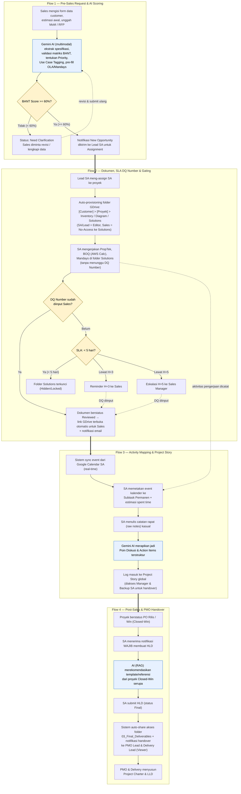
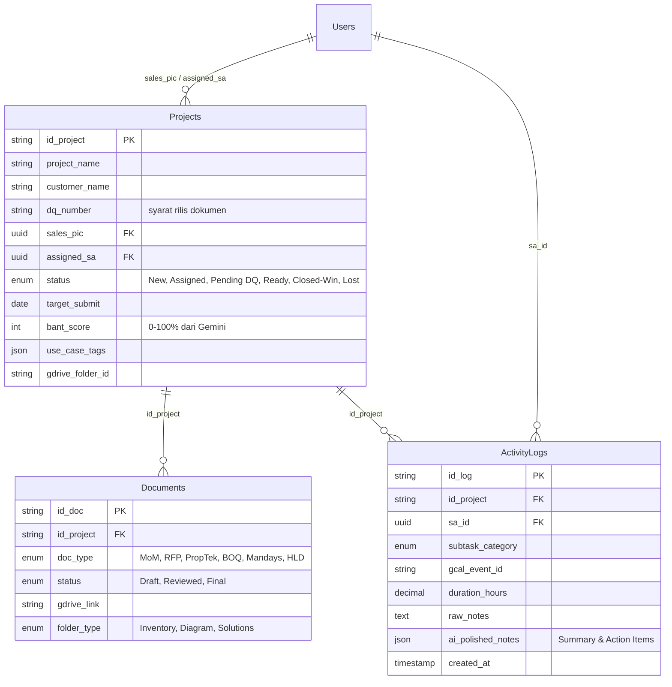

# Alur Bisnis Portal SA — Visualisasi Ground Truth

Dokumen ini adalah visualisasi **alur bisnis (business process flow)** Portal SA sebagaimana
didefinisikan di [`Spesifikasi_Teknis_Portal_SA.md`](Spesifikasi_Teknis_Portal_SA.md).

> **Sifat dokumen:** ini menggambarkan **perilaku produk yang dimaksudkan (intent)** sesuai spec —
> BUKAN status implementasi saat ini. Untuk jarak antara spec dan kode (apa yang sudah ✅ / 🟡 / 🔴),
> lihat [`docs/ROADMAP.md`](../docs/ROADMAP.md). Spec adalah sumber *niat*; kode adalah *realita*;
> roadmap adalah *jarak* di antara keduanya.

Diagram mengikuti empat alur kerja (workflow) di spec §2:

1. Pre-Sales Request & AI Scoring
2. Dokumen, SLA DQ Number & Gating System
3. Activity Mapping & Project Story
4. Post-Sales & PMO Handover

---

## Diagram Alur End-to-End

---

## Aktor & Peran

| Aktor | Peran dalam alur |
| :--- | :--- |
| **Sales** | Membuat opportunity, unggah MoM/RFP, input DQ Number, menerima akses dokumen |
| **Lead SA** | Menerima New Opportunity, meng-assign SA, memantau utilisasi |
| **SA** | Mengerjakan dokumen teknis, mapping aktivitas, membuat HLD |
| **Backup SA** | Mengakses Project Story saat SA utama cuti (handover) |
| **Sales Manager** | Menerima eskalasi SLA DQ Number (H+5) |
| **PMO Lead & Delivery Lead** | Menerima handover pasca Closed-Win untuk Project Charter & LLD |
| **Gemini AI** | BANT scoring, polishing activity notes, RAG recommendation |

## Integrasi yang Menggerakkan Alur (spec §4)

| Layanan | Titik dalam alur |
| :--- | :--- |
| **Google Drive** | Auto-provisioning folder + permission logic (Flow 2), handover folder (Flow 4) |
| **Google Calendar** | Pull event untuk activity mapping (Flow 3) |
| **Gmail** | Notifikasi trigger-based: assignment, update dokumen, eskalasi SLA, handover (semua flow) |
| **Google Gemini AI** | Multimodal parsing BANT (Flow 1), text structuring (Flow 3), RAG (Flow 4) |

---

## Entitas Data Inti (spec §3)

> Catatan: enum dan field di atas dikutip **persis dari spec §3**. Di beberapa titik, model kode
> aktual sudah menyimpang dari spec (mis. enum `status` proyek, taksonomi `subtask_category`).
> Divergensi itu dilacak sebagai keputusan di [`docs/ROADMAP.md`](../docs/ROADMAP.md) — dokumen ini
> tetap memegang versi spec sebagai ground truth.
