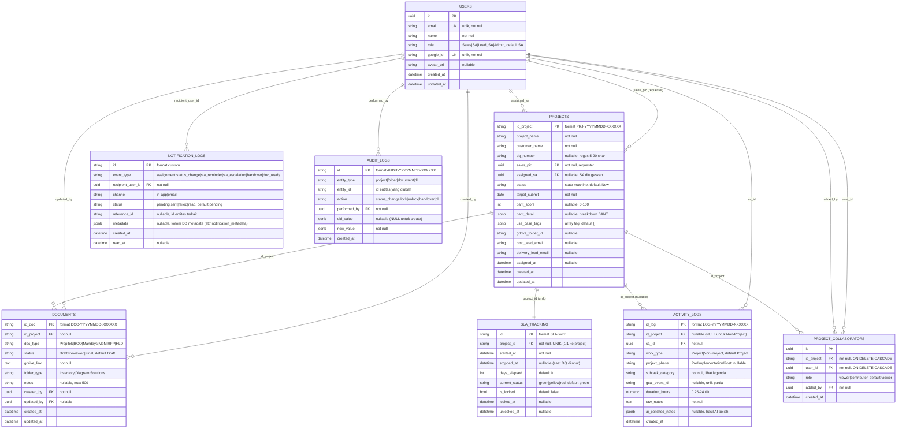

# ERD — Data Model Portal SA

Entity-Relationship Diagram untuk data model backend Portal SA. Diagram dibuat dari model SQLAlchemy aktual di `backend/app/models/` dan diverifikasi terhadap migration Alembic di `backend/alembic/versions/`.

> Catatan penting: model tidak mendefinisikan `relationship()` SQLAlchemy sama sekali — relasi antar-entity murni berupa `ForeignKey` di level kolom, dan join dilakukan manual lewat query di layer service/API. Diagram di bawah merepresentasikan FK constraint tersebut sebagai relasi.

## Diagram

## Legenda Entity

Semua entity didefinisikan sebagai model SQLAlchemy. `PK` = primary key, `FK` = foreign key, `UK` = unique key.

- **USERS** (`users`) — Pengguna sistem yang login via Google OAuth (atau demo login). Punya `role` dari empat nilai: `Sales`, `SA`, `Lead_SA`, `Admin`. `email` dan `google_id` dijaga unik. Semua FK dari entity lain yang menunjuk ke pengguna mengarah ke `users.id` (UUID).

- **PROJECTS** (`projects`) — Opportunity/proyek pre-sales. PK berupa string custom (`PRJ-YYYYMMDD-XXXXXX`). Kolom `sales_pic` adalah requester yang membuat proyek (bisa Sales, SA, atau Lead_SA — bukan selalu Sales walaupun namanya begitu), sedangkan `assigned_sa` adalah SA yang ditugaskan oleh Lead_SA (nullable). `status` dijaga oleh `CheckConstraint` dengan 10 nilai (lihat `WORKFLOW.md` untuk state machine). `bant_score` 0-100 dengan breakdown di `bant_detail` (JSONB). `use_case_tags` (JSONB array) dipakai untuk RAG recommendation.

- **DOCUMENTS** (`documents`) — Metadata dokumen proyek yang disimpan di Google Drive (hanya link + metadata, bukan file-nya). `doc_type` terbatas pada `PropTek`, `BOQ`, `Mandays`, `MoM`, `RFP`, `HLD`. `folder_type` menentukan lokasi: `Inventory`, `Diagram`, atau `Solutions`. `status` mengikuti state machine `Draft → Reviewed → Final`.

- **ACTIVITY_LOGS** (`activity_logs`) — Catatan aktivitas harian SA. Mendukung dua `work_type`: `Project` (wajib punya `id_project` + `project_phase`) dan `Non-Project` (keduanya harus NULL) — konsistensi ini dijaga oleh `CheckConstraint` `chk_activity_logs_worktype_consistency`. `raw_notes` adalah input mentah SA; `ai_polished_notes` (JSONB) berisi hasil AI polishing (`discussion_points` + `action_items`). `gcal_event_id` punya partial unique index — satu event Google Calendar hanya bisa dipetakan sekali.

- **PROJECT_COLLABORATORS** (`project_collaborators`) — Join table peer/atasan yang di-tag ke proyek. `role` kolaborator: `viewer` (lihat saja) atau `contributor` (bisa tambah activity log). `UniqueConstraint(id_project, user_id)` memastikan satu user hanya sekali per proyek. FK ke `projects` dan `users` memakai `ON DELETE CASCADE`.

- **NOTIFICATION_LOGS** (`notification_logs`) — Riwayat notifikasi per penerima. Kolom JSONB di DB bernama `metadata`, tetapi atribut Python-nya `notification_metadata` (karena `metadata` reserved oleh SQLAlchemy Declarative). **Lihat catatan bug B1 di bawah.** `channel` = `in-app`/`email`; status pengiriman = `pending`/`sent`/`failed`/`read`.

- **AUDIT_LOGS** (`audit_logs`) — Jejak audit perubahan data. Generik: `entity_type` + `entity_id` menunjuk entitas apa pun (string, bukan FK), `old_value`/`new_value` (JSONB) menyimpan snapshot. Dipakai oleh workflow transition, serta lock/unlock/handover.

- **SLA_TRACKING** (`sla_tracking`) — Tracker SLA countdown DQ Number. Relasi **1:1** ke proyek karena `project_id` punya `UniqueConstraint`. Timer dimulai saat proyek `Assigned` dan berhenti saat DQ Number diinput. `current_status` (`green`/`yellow`/`red`) merepresentasikan badge SLA; `is_locked` menandai folder Solutions terkunci.

## Catatan Relasi & Enum

- **Dua FK dari PROJECTS ke USERS**: `sales_pic` (requester) dan `assigned_sa` (SA ditugaskan). Keduanya menunjuk ke `users.id` yang sama tetapi makna berbeda.
- **ACTIVITY_LOGS.id_project nullable**: diubah menjadi nullable oleh migration `003` untuk mendukung aktivitas `Non-Project`. Model dan migration sudah selaras pada titik ini.
- **Enum/`CheckConstraint` yang ditegakkan di DB**:
  - `users.role`: `Sales`, `SA`, `Lead_SA`, `Admin`.
  - `projects.status`: `New`, `Pending Assignment`, `Assigned`, `Ready`, `Closed-Win`, `Handover Complete`, `Lost`, `Need Clarification`, `Scoring Pending`, `Manual Review Required`.
  - `documents.doc_type`: `PropTek`, `BOQ`, `Mandays`, `MoM`, `RFP`, `HLD` (tipe `Requirement` **belum ada** — lihat roadmap fitur 7 / 1.2).
  - `documents.status`: `Draft`, `Reviewed`, `Final`. `documents.folder_type`: `Inventory`, `Diagram`, `Solutions`.
  - `activity_logs.subtask_category` (union Project + Non-Project): `Assessment`, `Internal Meeting`, `Customer Meeting`, `Principal Meeting`, `Commercial Document`, `Technical Document`, `Document Review`, `Training`, `Self-Lab`, `Self-Learning`, `Exam`, `Internal Presentation`, `External Presentation`. Kecocokan subtask ↔ `work_type` divalidasi di layer schema Pydantic, bukan DB.
  - `activity_logs.work_type`: `Project`, `Non-Project`. `activity_logs.project_phase`: `Pre-Implementation`, `Implementation`, `Post-Implementation`.
  - `notification_logs.event_type`: `assignment`, `status_change`, `sla_reminder`, `sla_escalation`, `handover`, `doc_ready`. `notification_logs.channel`: `in-app`, `email`. `notification_logs.status`: `pending`, `sent`, `failed`, `read`.
  - `sla_tracking.current_status`: `green`, `yellow`, `red`.

### Discrepancy kode vs runtime (penting)

- **Bug B1 (data integrity, aktif):** `assignment.py` (`assign`/`reassign`) dan `scoring_engine.py` (`_notify_lead_sa`) membuat `NotificationLog(..., metadata={...})`. Atribut model yang benar adalah `notification_metadata` (lihat `notification_log.py`). Memberi keyword `metadata=` ke constructor SQLAlchemy akan raise saat runtime — jadi notifikasi assignment dan notifikasi scoring ke Lead_SA gagal. `sla_timer.py` dan `notification_service.py` sudah memakai `notification_metadata=` dengan benar. Sejalan dengan roadmap B1.
- **`event_type="reassignment"`** di `assignment.py` (`reassign_sa_to_project`) **tidak termasuk** dalam `CheckConstraint` `chk_notification_logs_event_type` (`assignment`, `status_change`, `sla_reminder`, `sla_escalation`, `handover`, `doc_ready`). Seandainya B1 diperbaiki, INSERT ini tetap akan ditolak oleh constraint DB.
- **`estimasi_nilai` tidak dipersist (B4):** divalidasi dan dikembalikan di response `create_project`, tetapi tidak ada kolomnya di model `Project`.
- **`schema drift` potensial (B5):** `main.py` memanggil `Base.metadata.create_all` saat startup, bersaing dengan Alembic sebagai mekanisme migration.

> Content was rephrased for compliance with licensing restrictions.
