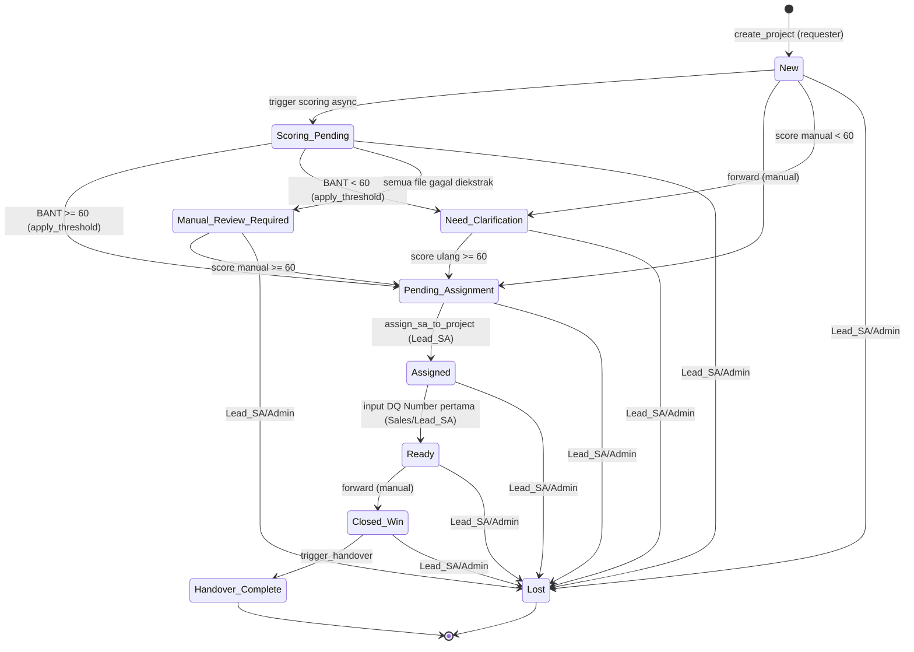
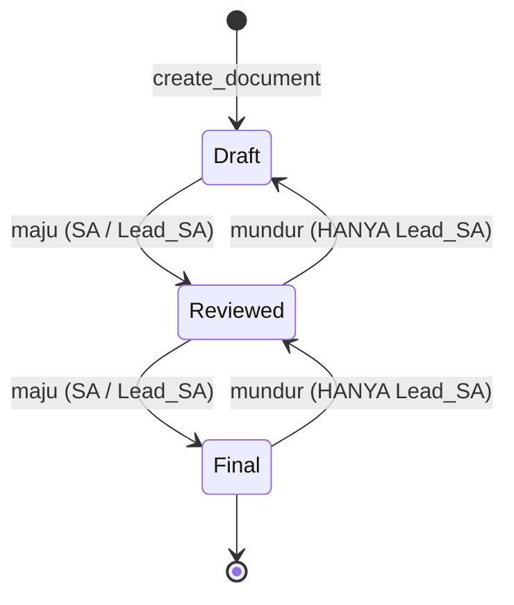
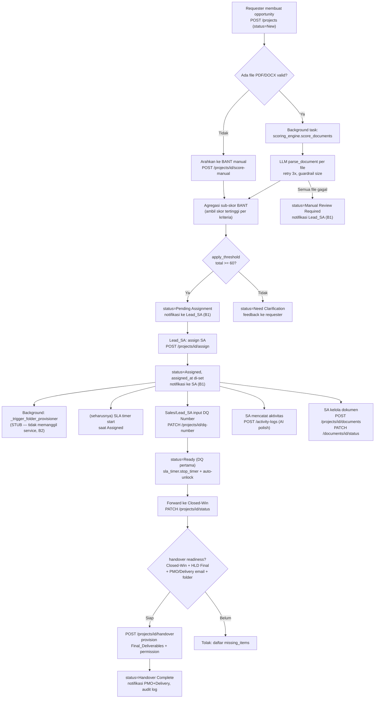
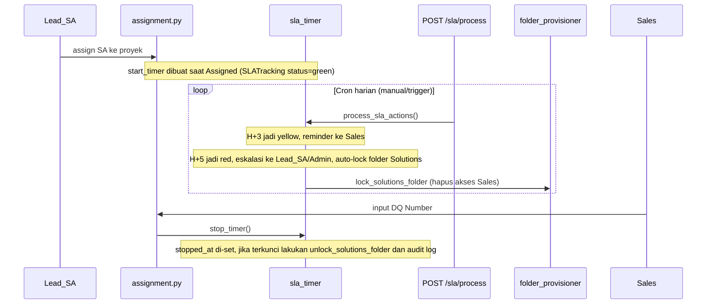

# WORKFLOW — Alur Domain Backend Portal SA

Dokumen ini menjelaskan alur bisnis end-to-end backend Portal SA: dari pembuatan opportunity oleh requester, BANT scoring, assignment oleh Lead SA, folder provisioning, lifecycle dokumen, SLA tracking DQ Number, hingga handover ke PMO/Delivery. Diagram dibuat dari kode aktual di `backend/app/api/` dan `backend/app/services/`.

## 1. State Machine Status Proyek

Transisi status proyek ditegakkan di dua tempat: endpoint `PATCH /projects/{id}/status` (`workflow.py`, transisi manual oleh user) dan `scoring_engine.apply_threshold` (transisi otomatis hasil scoring).

### Catatan state machine proyek

- **Jalur forward manual** (`workflow.py`, `VALID_FORWARD_TRANSITIONS`) bersifat **linear ketat**: `New → Pending Assignment → Assigned → Ready → Closed-Win → Handover Complete`. Endpoint ini hanya mengizinkan satu langkah maju per transisi.
- **Jalur otomatis** dari scoring engine: `apply_threshold` menetapkan `Pending Assignment` (skor ≥ 60, memicu notifikasi Lead_SA) atau `Need Clarification` (skor < 60). Jika semua file gagal diekstrak LLM setelah retry, status menjadi `Manual Review Required`.
- **Perbedaan jalur**: transisi `Assigned → Ready` **tidak** terjadi via `workflow.py` dalam praktik — ia dipicu di `dq_number.py` saat DQ Number pertama diinput (dan status saat ini `Assigned`). Transisi `Pending Assignment → Assigned` dipicu di `assignment.py`, bukan oleh endpoint workflow.
- **`Lost`** hanya bisa diset oleh `Lead_SA`/`Admin`, dari status mana pun kecuali `Handover Complete` dan `Lost` sendiri.
- **Status `Scoring Pending`** terdaftar di `CheckConstraint` tetapi tidak pernah di-set secara eksplisit oleh kode scoring (scoring langsung menuju `Pending Assignment`/`Need Clarification`/`Manual Review Required`). Diagram menampilkannya sebagai fase konseptual "sedang di-score".
- Tidak ada step "qualify" terpisah — gate kualifikasi secara de-facto adalah ambang BANT ≥ 60 (lihat roadmap keputusan 2.3).

## 2. State Machine Status Dokumen

Ditegakkan di `PATCH /documents/{id}/status` (`documents.py`).

### Catatan state machine dokumen

- **Maju** (`Draft → Reviewed → Final`): boleh oleh `SA` dan `Lead_SA`.
- **Mundur** (`Final → Reviewed`, `Reviewed → Draft`): hanya `Lead_SA`.
- **Loncat** (`Draft → Final`): ditolak untuk semua role.
- Dokumen berstatus `Final` hanya bisa diubah oleh `Lead_SA` (proteksi tambahan).
- Dokumen `HLD` berstatus `Final` adalah salah satu prasyarat handover.

## 3. Alur End-to-End (Lintas Service)

## 4. Alur SLA Timer DQ Number

### Catatan SLA

- Threshold: `green` 0-2 hari, `yellow` 3-4 hari, `red` 5+ hari (`sla_timer.py`).
- `process_sla_actions` tidak dijadwalkan otomatis di dalam app — harus dipanggil lewat `POST /api/v1/sla/process` (hanya `Admin`/`Lead_SA`), biasanya oleh cron eksternal.
- `start_timer` **ada dan idempotent**, tetapi perlu dicatat: pemanggilannya saat assignment bergantung pada wiring provisioning; karena `_trigger_folder_provisioner` masih stub (B2), `gdrive_folder_id` tidak pernah terisi, sehingga auto-lock/unlock folder Solutions tidak akan berjalan di runtime nyata (service-nya sendiri lengkap, hanya tidak ter-wire).

## 5. Pemicu Transisi (ringkasan)

| Transisi | Pemicu | Endpoint / Service | Role |
|----------|--------|--------------------|------|
| `-` → `New` | Requester buat opportunity | `POST /projects` | Sales/SA/Lead_SA |
| `New` → `Pending Assignment` / `Need Clarification` / `Manual Review Required` | Hasil BANT scoring | `scoring_engine.apply_threshold` (async) atau `POST /projects/{id}/score-manual` | otomatis / Sales |
| `Pending Assignment` → `Assigned` | Assign SA | `POST /projects/{id}/assign` | Lead_SA/Admin |
| `Assigned` → `Ready` | Input DQ Number pertama | `PATCH /projects/{id}/dq-number` | Sales/Lead_SA/Admin |
| `Ready` → `Closed-Win` | Forward manual | `PATCH /projects/{id}/status` | sesuai akses proyek |
| `Closed-Win` → `Handover Complete` | Trigger handover | `POST /projects/{id}/handover` | SA ditugaskan/Lead_SA/Admin |
| `* ` → `Lost` | Set Lost | `PATCH /projects/{id}/status` | Lead_SA/Admin |
| doc `Draft`→`Reviewed`→`Final` | Update status dokumen | `PATCH /documents/{id}/status` | SA/Lead_SA (mundur: Lead_SA) |
| SLA start | Saat proyek `Assigned` | `sla_timer.start_timer` | otomatis |
| SLA stop + unlock | Input DQ Number | `sla_timer.stop_timer` | otomatis |
| SLA lock + eskalasi | H+5 tanpa DQ | `sla_timer.process_sla_actions` | cron (Admin/Lead_SA) |

> Content was rephrased for compliance with licensing restrictions.
